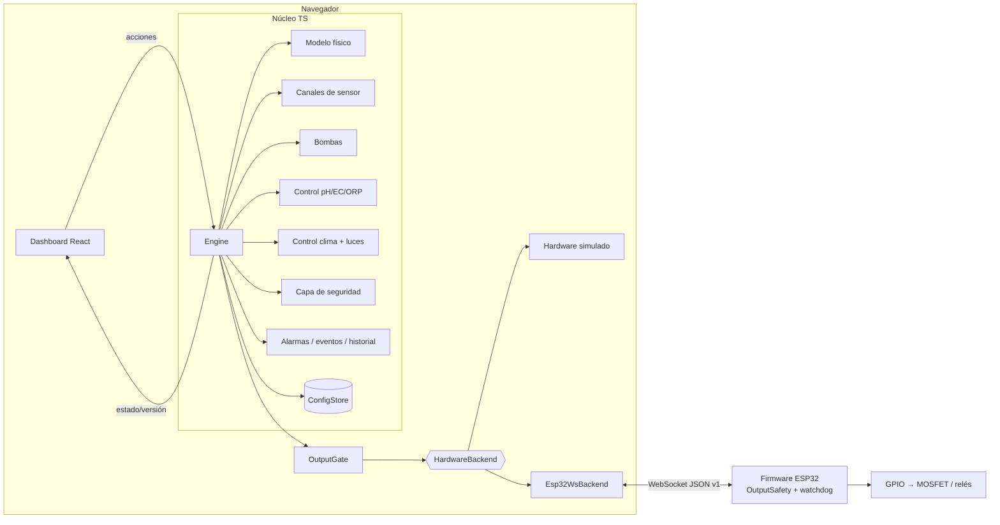

# Arquitectura técnica

## Visión general



Módulos (sección 2 del enunciado → código):

| # | Módulo | Ubicación |
|---|--------|-----------|
| 1 | Frontend / dashboard | `src/ui/` |
| 2 | Motor de simulación física | `src/core/physics/plant.ts`, `src/core/engine.ts` |
| 3 | Motor de reglas y automatización | `src/core/control/chemistry.ts`, `climate.ts`, `lights.ts` |
| 4 | Abstracción de sensores | `src/core/sensors/sensor.ts` (`SensorDriver`, `RawSample`) |
| 5 | Abstracción de actuadores | `src/core/actuators/pumps.ts`, relés en `control/climate.ts`, `OutputFrame` |
| 6 | Perfiles ambientales | `src/core/profiles.ts`, `config.ts` |
| 7 | Alarmas e interbloqueos | `src/core/alarms.ts`, `src/core/safety/safety.ts` |
| 8 | Historial de variables y eventos | `src/core/history.ts`, `EventLog` |
| 9 | Comunicación ESP32 | `src/hal/` + `firmware/esp32/` |
| 10 | Configuración persistente / exportación | `src/core/persistence.ts` |

El núcleo es TypeScript puro y determinista (RNG con semilla): se ejecuta igual en el
navegador y en Node (pruebas, comparación de escenarios).

## Paso de simulación (1 s simulado)

1. **Enlace**: heartbeat del controlador (virtual en simulación, real en hardware). Sin heartbeat
   durante `commTimeoutS` → **estado seguro** (bombas paradas, salidas apagadas, automatización
   abortada, desarme). Salir exige acción del operador con el enlace sano.
2. Perturbaciones programadas del escenario.
3. Modelo físico con las salidas *aplicadas* en el paso anterior.
4. Muestreo de los 6 sensores.
5. Bombas: entrega de líquido, consumo del recipiente, detección de vacío, **corte duro por
   tiempo máximo** + vigilancia independiente del oxidante.
6. Controlador químico.
7. Controlador climático (histéresis, tiempos mínimos, interbloqueo hum/deshum, luces).
8. Composición de salidas → planta (simulación) o `OutputGate` (hardware).
9. Alarmas e historial.

Cualquier excepción dentro del paso activa `ENGINE_FAULT`: simulación detenida, todo apagado,
estado seguro. En modo simulación la compuerta **no envía nada** al hardware.

## Modelo de datos

Definido en `src/core/types.ts`. Entidades principales:

- `SystemConfig`: sensores, líquidos, bombas, compatibilidad, subsistema oxidante, clima,
  perfiles (`veg`, `flower`), control, parámetros del modelo físico.
- `SensorRuntime` / `SensorReading`: `value`, `raw`, `status` (`ok | disconnected | fault |
  out_of_range | stale | uncalibrated | suspect`), `quality` (`good | uncertain | bad`),
  `source` (`simulated | manual | hardware`), marca de tiempo, mensaje; calibración
  (`gain`, `bias`, fecha, puntos); fallos inyectables.
- `PumpConfig` / `PumpRuntime`: caudal, duración, volumen, intervalo mínimo, tiempo máximo,
  capacidad, umbral de vacío, cebado, bloqueo, contadores y registro de dosis.
- `ProfileConfig`: bandas (`target`, `deadband`, `alarmLow`, `alarmHigh`) para pH, EC, ORP,
  temperatura del agua, temperatura y HR; reglas de ventilación; horario de luces; relaciones
  de dosificación; qué se automatiza. **Todo empieza en `null`**.
- `LoopRuntime` + `Decision`: fase del lazo y registro de decisiones con justificación.
- `Alarm`: clave, código, severidad, origen, mensaje, **causa**, **acción tomada**, fecha de
  activación, normalización y reconocimiento.

## Interfaces para sustituir simulación por hardware

```ts
// Sensor: cualquier fuente produce una RawSample y pasa por el mismo pipeline
interface SensorDriver { sample(now: number): RawSample }

// Hardware: único punto de contacto con un dispositivo
interface HardwareBackend {
  readonly kind: 'mock' | 'esp32-ws';
  readonly isPhysical: boolean;
  connect(): void; disconnect(): void; tick(now: number): void;
  link(): BackendLink;                      // conexión, heartbeat, armado, E-STOP, fallos
  latestSensors(): SensorFrame | null;      // valores crudos
  reportedOutputs(): Record<OutputId, boolean> | null;
  writeOutputs(frame: OutputFrame): void;   // solo lo llama OutputGate
  requestArm(armed: boolean, token: string): void;
}

// Persistencia
interface ConfigStore { load(): PersistedState | null; save(s: PersistedState): void; clear(): void }
```

Para añadir otro transporte (serie USB, MQTT) basta con implementar `HardwareBackend`
(ver `src/hal/esp32Ws.ts` como referencia, con transporte inyectable).

## Motor de reglas

### pH / EC / ORP (`control/chemistry.ts`)

```
idle ──desviación > banda──▶ confirming ──persistente confirmS──▶ [seguridad OK] ──▶ dosing
  ▲                                                                                   │
  └──── medición estable ◀── stabilizing (mín. stabilizeS, σ ≤ tolerancia) ◀── mixing (mixS)
```

- Un solo lazo corrige a la vez (depósito compartido); orden configurable (EC → pH → ORP).
- Dosis = `clamp(|error| · fracción / estimación · V, mín, máx)`. La **estimación** es del
  controlador y es independiente del modelo del simulador (escenario "Modelo erróneo").
  Sin estimación o sin volumen nominal → no dosifica.
- EC: secuencia Silicio → A → B → Bloom → PK con separación entre pasos y relaciones del perfil.
- EC alta / ORP alto: no hay actuador; alarma y acción manual.
- Antirruido: filtro + banda muerta + confirmación + espera de mezcla y estabilización +
  límite de correcciones/hora + bloqueo tras N correcciones sin respuesta.
- Cada decisión queda en el registro con su justificación.

### Clima (`control/climate.ts`)

Histéresis por banda muerta, tiempos mínimos ON/OFF, interbloqueo humidificador/deshumidificador
(salvo justificación configurada), ventilación por temperatura, HR alta o ciclo periódico,
estado de fallo configurable si falla el sensor, protección térmica de luces.

### Luces (`control/lights.ts`)

El estado se deriva solo de la hora y del horario guardado (sin contadores): tras reiniciar,
el ciclo continúa exactamente donde debía. Fotoperiodo fijo (p. ej. 18/6), sin cambios automáticos.

## Capa de seguridad (`safety/safety.ts`)

Toda orden de bomba (automática, prueba, cebado, mantenida) pasa por `evaluatePumpStart`:

- E-STOP, estado seguro, armado en hardware, bomba habilitada/bloqueada/en marcha.
- Recipiente vacío o volumen insuficiente; duración > tiempo máximo.
- Concurrencia: por defecto una bomba a la vez. Si se permite simultaneidad, solo pares
  `compatible`; `unknown` se bloquea hasta validación del usuario; `incompatible` siempre.
- Oxidante: subsistema independiente (`evaluateOxidant` + `oxidantRuntimeCheck`): habilitación
  explícita con advertencias aceptadas, máximo por operación y diario, separación temporal con
  cualquier otro producto, nunca mantenido, ORP límite absoluto y, en automático, verificación
  independiente vigente. En el firmware hay además una salida de habilitación física (`OX_EN`).
- Solo automático: modo, automatización activa, bomba cebada, intervalo mínimo y **sensores
  relevantes válidos y calibrados** (pH±→pH; nutrientes→EC; oxidante→ORP y pH).

## Qué es validado y qué es aproximado

| Elemento | Tipo |
|----------|------|
| Presión de saturación (Magnus) y conversión HR ↔ humedad absoluta | Ecuación empírica validada |
| Balance térmico de un nodo, ventilación, infiltración, transpiración | Aproximación |
| Temperatura del agua (primer orden) | Aproximación |
| Efecto de cada líquido (lineal por mL/L) | Aproximación configurable, **no validada** |
| Mezcla del depósito (primer orden), derivas de pH/EC, relajación del ORP | Aproximación |
| Errores de sonda, ruido, picos | Modelo de prueba |

La interfaz lo indica en *Configuración* y en cada vista relevante. Ningún resultado debe
leerse como predicción exacta.
